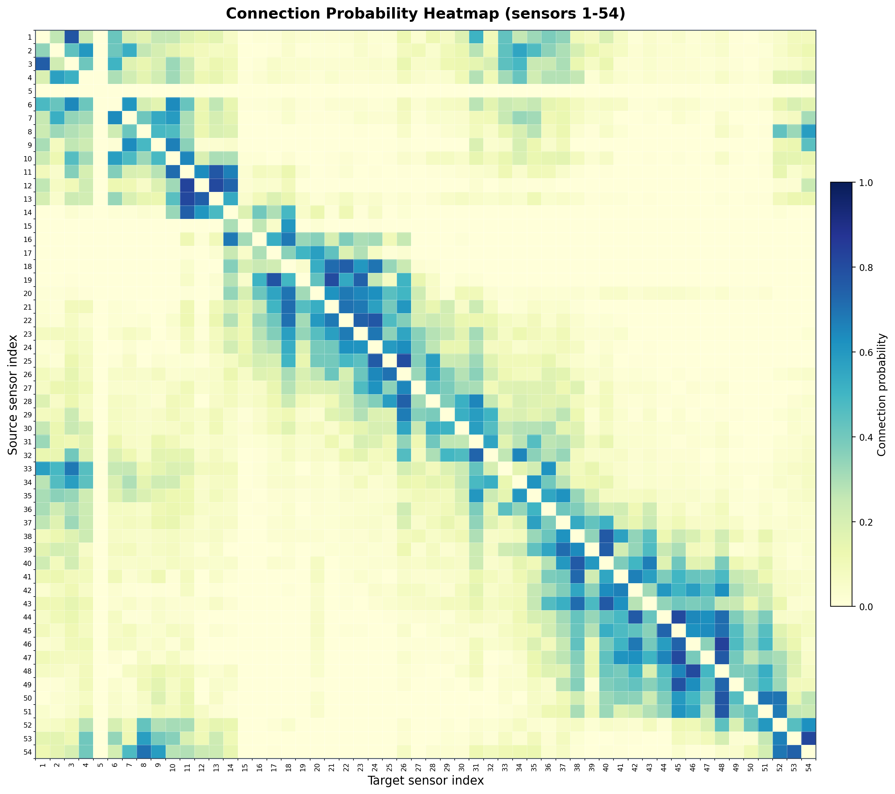
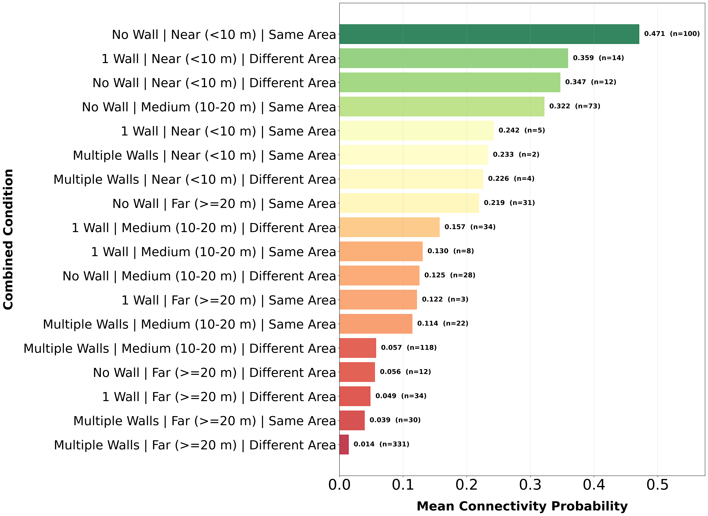

# Sensor connection information

The supplied 54-sensor heatmap shows pairwise connection probabilities. The grouped analysis summarizes mean probabilities by distance, intervening wall count and area membership. Nearby pairs with fewer intervening walls generally have higher connection probabilities. The released building tables use the annotation exporter's geometry-dependent prior, exp(−2.2d/L − 0.85w), where d is distance, L is the annotated plan diagonal and w is the intervening wall count. BRICK normalizes this prior and uses it to modulate graph edge weights with the fixed coefficient 0.5.

